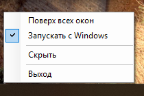

# TrayTemps

Температуры **ЦП, ГП, диска и материнской платы** прямо на панели задач Windows — прозрачной надписью слева от индикатора языка.


```
ЦП 59°   ГП 39°   ДИСК 40°   ПЛАТА 28°
```

Без рамки и фона: per-pixel alpha (как у виджетов вроде Pulsar/Rainmeter), мягкая тень под цифрами, подсветка по температуре и компактное меню по правому клику.



## Возможности

- **ЦП** — пакет процессора (LibreHardwareMonitor), с откатом на максимум ядер.
- **ГП** — ядро видеокарты (LHM), при недоступности — `nvidia-smi`.
- **ДИСК** — NVMe (LHM), при недоступности — Windows Storage WMI.
- **ПЛАТА** — датчик платы (LHM) либо ACPI-термозона.
- Обновление раз в 2 секунды; последнее удачное значение удерживается, если датчик «уснул».
- Цвета: зелёный < 50 °C, белый 50–70, янтарный ≥ 70, красный ≥ 85.
- Позиция — по центру высоты панели задач, сразу слева от области уведомлений.
- Панель не исчезает от кликов: раз в 300 мс она заново ставит себя в топ, потому что панель задач — тоже topmost-окно и иначе перекрывает её.
- Меню открывается **правым кликом** по надписи (вся её площадь кликабельна, включая прозрачные поля); клик в любом месте вне меню закрывает его, левый клик по панели ничего не делает.
- В трее — иконка с температурой ЦП.

## Меню (правый клик по надписи)

| Пункт | Что делает |
|---|---|
| **Поверх всех окон** | включено — панель каждые 300 мс отвоёвывает топ и остаётся видимой поверх игр в безрамочном/оконном полноэкранном режиме; выключено — с играми не спорит, но над панелью задач удерживается всегда |
| **Запускать с Windows** | включает/выключает ярлык в автозагрузке |
| **Скрыть** | убирает панель до двойного клика по иконке в трее |
| **Выход** | закрывает приложение |

Настройка «Поверх всех окон» хранится в `%APPDATA%\dsh-tray-temps\settings.txt`. Панель исчезает только по пункту «Скрыть» или при выходе — клики по ней ничего не прячут.

Известное ограничение: эксклюзивный полноэкранный режим (DirectX exclusive) перекрывает любые сторонние окна — панель там не видна. В borderless и оконном режиме работает.

## Установка

### Вариант 1: готовый архив (рекомендуется)

1. Скачайте `TrayTemps-1.0.0-win64.zip` со страницы [Releases](https://github.com/NeptunT90/tray-temps/releases).
2. Распакуйте в постоянную папку, например `C:\Tools\TrayTemps`.
3. Запустите `TrayTemps.exe` — Windows покажет UAC (нужен доступ к датчикам через kernel-драйвер).
4. Чтобы запускать при входе в систему, отметьте в меню **«Запускать с Windows»** или запустите `install-autostart.cmd`.

### Вариант 2: скрипт установки

```powershell
irm https://raw.githubusercontent.com/NeptunT90/tray-temps/main/install/install.ps1 | iex
```

Скрипт скачивает последний релиз, распаковывает в `%LOCALAPPDATA%\TrayTemps`, создаёт ярлык автозапуска и запускает приложение. Удаление — `install/uninstall.ps1`.

Можно и без интернета: скрипт лежит в репозитории, `install/install.ps1 -NoAutostart`, если ярлык не нужен.

### Требования

- Windows 10/11 x64.
- .NET Framework 4.8 (РІС…РѕРґРёС‚ РІ Windows 10 1903+ Рё Windows 11).
- Права администратора — без них LibreHardwareMonitor не откроет датчики CPU/диска (ГП и плата работают и без них).

## РЎР±РѕСЂРєР°

Нужен только `csc.exe` из состава Windows (.NET Framework 4.8); библиотеки датчиков скачиваются из официального релиза LibreHardwareMonitor:

```bat
build\build.ps1 -Version 1.0.0
```

Скрипт кладёт в `dist\` собранный `TrayTemps.exe`, зависимости, `TrayTemps.exe.config` (в нём `loadFromRemoteSources` и binding redirects) и пакует `TrayTemps-<версия>-win64.zip`.

## Диагностика

Лог ошибок датчиков: `%APPDATA%\dsh-tray-temps\error.log`.

## Лицензия

Код приложения — MIT (см. [LICENSE](LICENSE)).
Библиотеки датчиков распространяются под своими лицензиями — см. [THIRD-PARTY-NOTICES.md](THIRD-PARTY-NOTICES.md). LibreHardwareMonitor — MPL-2.0, исходники: https://github.com/LibreHardwareMonitor/LibreHardwareMonitor.

